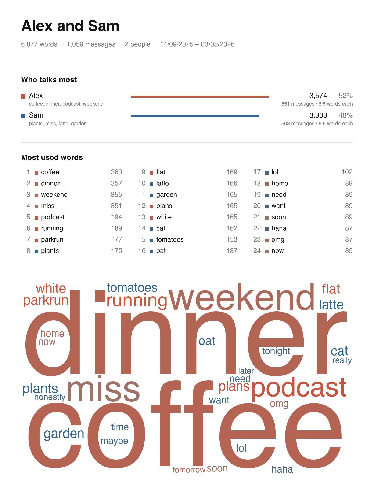
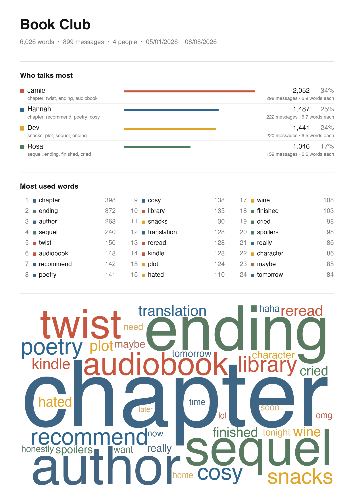

# howchat: WhatsApp & iMessage chat stats and word cloud generator

**howchat** turns any WhatsApp chat export or iMessage conversation into a clean, shareable stats card. It shows who texts the most, everyone's most used words, and a word cloud coloured by who says each word. It's a free, open-source Python script that runs **entirely on your own computer**: your messages are never uploaded anywhere.

<p align="center">
  
  
  
</p>

<sub>Example cards are generated from made-up chats in <a href="examples/">examples/</a>.</sub>

## What you get

- **Who talks most:** total words per person, share of the chat, message count and average words per message, ranked
- **Most used words:** the top 24 words across the whole chat, plus each person's favourite words
- **Word cloud:** each word is coloured by the person who uses it most, relative to how much they talk overall. A clear favourite shows full colour, and a close call shows paler
- **One PNG per chat:** ready to drop into the group chat
- **WhatsApp and iMessage:** works with WhatsApp exports from iPhone and Android, and reads iMessage / SMS history straight from the Mac Messages app
- **Private by default:** everything runs locally with no accounts, no API and no uploads

## Install

Requires Python 3.9+.

```bash
git clone https://github.com/plusevie/howchat.git
cd howchat
python3 -m venv .venv
.venv/bin/pip install -r requirements.txt
```

## WhatsApp chat analysis

1. In WhatsApp, open the chat → tap the name → **Export Chat** → **Without Media**.
2. Save the `.zip` (or the `_chat.txt` inside it) to your computer.
3. Run:

```bash
.venv/bin/python wac.py "WhatsApp Chat - Pizza Crew.zip"
```

You can pass several chats at once. Each one gets its own card, named after the chat:

```bash
.venv/bin/python wac.py chat1.zip chat2.zip --outdir cards
```

Try it on the example chat:

```bash
.venv/bin/python wac.py examples/whatsapp-pizza-crew.txt --title "Pizza Crew"
```

## iMessage chat analysis (macOS)

Your Mac keeps your full Messages history in a local database, so no export is needed.

1. Give your terminal app **Full Disk Access**: System Settings → Privacy & Security → Full Disk Access → turn on Terminal (or iTerm / VS Code), then reopen it.
2. List your chats, most active first:

```bash
.venv/bin/python wac.py --imessage
```

3. Make cards by list number, contact name, group name or phone number:

```bash
.venv/bin/python wac.py --imessage 1 "Mum" "Book Club" --me "Your Name"
```

Contact names are looked up from your local Contacts. SMS and iMessage threads with the same person are merged, even when they use a phone number in one thread and an email in another. Tapbacks and system messages are ignored. The Messages database is copied and read-only, so howchat never changes your messages.

## Options

| Option | What it does |
| --- | --- |
| `--outdir DIR` | Where to save the PNG cards (default: current folder) |
| `--title "Name"` | Override the card title (single chat) |
| `--me "Name"` | Your name on iMessage cards (default: `Me`) |
| `--top N` | How many top words to print in the terminal |
| `--keep-stopwords` | Include common words like *the*, *and*, *yeah* |
| `--bg COLOUR\|IMAGE` | Background colour (`#ffffff`, `black`…) or a photo |
| `--font PATH` | Font file (default: Helvetica on macOS) |
| `--contrast N` | How strongly a small lead pulls a word to that person's colour (default `3`, `1` = linear) |
| `--people N` | How many people get their own colour (default `8`) |

## FAQ

**Is it safe to use with private chats?**
Yes. howchat is a local script with no network access. Your chats never leave your machine.

**Does it work on Windows or Linux?**
WhatsApp analysis works anywhere Python runs. iMessage analysis needs macOS, because that's where the Messages database lives.

**Which WhatsApp export formats are supported?**
Both the iPhone format (`[dd/mm/yyyy, hh:mm:ss] Name: message`) and the Android format (`dd/mm/yyyy, hh:mm - Name: message`), as `.txt` or `.zip`. Multi-line messages, media placeholders, deleted messages and links are handled.

**Why does someone appear twice in my iMessage list?**
Their phone number and email are probably on separate contact cards. Merge the cards in Contacts and they'll show up as one chat.

## License

MIT
